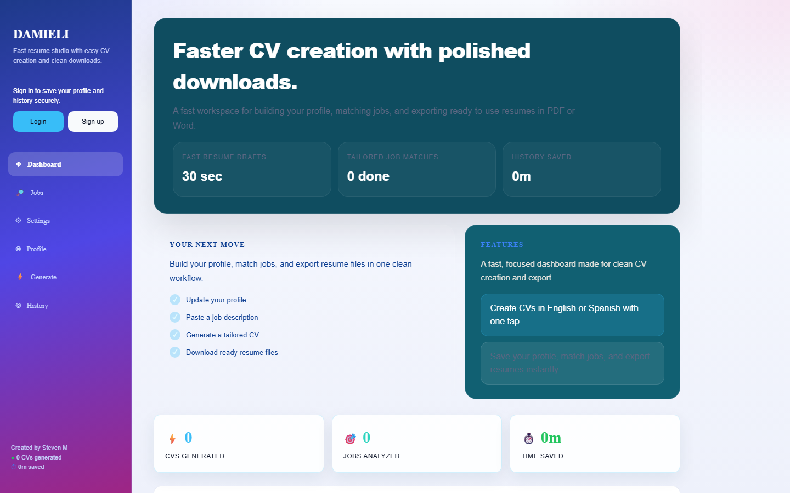
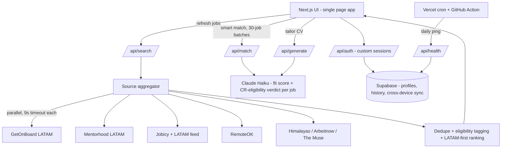

# DAMIELI

**AI job search + CV tailor, built for applying to remote jobs from Costa Rica.**

Live: **[damieli.vercel.app](https://damieli.vercel.app)**



DAMIELI pulls jobs from 7+ boards, uses Claude to score how well *every* job fits your real background (not keyword matching), judges whether each one is actually applyable from Costa Rica, and generates a tailored CV in English or Spanish for the ones worth pursuing.

## Why it exists

Job boards are built for US/EU applicants. For someone in Latin America, most "remote" listings are dead ends — they quietly require US work authorization, UK residency, or EU presence, and you only find out after writing the application. DAMIELI treats *eligibility* as a first-class signal, ranks LATAM-friendly positions first, and never surfaces boards that charge candidates to apply.

## Architecture



A separate local companion tool ([damieli-apply](../damieli-apply)) handles Costa-Rica boards that block cloud traffic — see problem #3 below.

## Interesting problems solved

### 1. Scoring *every* job with AI inside serverless limits
Scoring 400 jobs in one LLM call blows past token and time limits; scoring only the visible page gave a false picture. Solution: the client slices the pool into **30-job batches and fires them in parallel** against `/api/match`. Each batch is one Claude call returning compact JSON (`score`, `reason`, `eligible`, `eligReason` per job). Every job in the pool gets a real verdict in roughly the time of one call.

### 2. "Can I actually apply to this from Costa Rica?"
Keyword rules ("US only", "visa") missed most restrictions — jobs say "must have the right to work in the UK" a hundred different ways. Two layers now:
- **Heuristic pre-tag at fetch time** (`latam` / `worldwide` / `us_only` / `restricted` / `unknown`) so the list ranks applyable jobs first *before* the 400-job cap trims the pool.
- **AI judgment during matching**: the model reads the job's real requirements text and returns a strict yes/no/maybe *with a stated reason*, which overrides the heuristic in the UI.

### 3. Job boards that block datacenter IPs
Computrabajo (the biggest Costa-Rica board) returns errors for requests from Vercel's IP range — scraping it server-side is impossible. Instead of dropping the best local source, the scraper lives in a **local Node/Playwright companion tool**: it pulls ~190 CR jobs on my machine (residential IP), and a human-in-the-loop script pre-fills each application, then pauses for me to review and submit. The web app exports its shortlist in the tool's format, so the two halves cooperate.

### 4. Free-tier infrastructure that stays alive
Supabase pauses free projects after a week without traffic — which silently breaks login. A **daily Vercel cron** pings `/api/health` (which touches the database), with a **GitHub Actions workflow as backup** in case the cron is missed. Cost: $0.

### 5. One slow job board can't break the search
All sources run in parallel under `Promise.allSettled` with a **9-second per-source timeout**. A dead or slow board degrades results by one source instead of hanging the whole request; failures are collected and reported, never thrown.

## Stack

| Layer | Choice |
|---|---|
| Framework | Next.js 16 (App Router, API routes), React, TypeScript |
| AI | Anthropic API — Claude Haiku 4.5 (scoring, eligibility, CV generation) |
| Data | Supabase (Postgres) — profiles, history, cross-device sync |
| Auth | Custom session tokens (HMAC-signed), bcrypt-style hashing |
| Hosting | Vercel (auto-deploy on push) + Vercel cron |
| Job sources | GetOnBoard, Mentorhood, Jobicy (+LATAM feed), RemoteOK, Himalayas, Arbeitnow, The Muse; JSearch/Adzuna optional (key-gated) |

## Running locally

```bash
npm install
# .env.local:
#   ANTHROPIC_API_KEY=...        # required — scoring + CV generation
#   AUTH_SECRET=...              # required in production builds — session signing
#   SUPABASE_URL=...             # account storage (app runs without it, nothing persists)
#   SUPABASE_SECRET_KEY=...
#   RAPIDAPI_KEY=...             # optional — JSearch source
#   ADZUNA_APP_ID=... ADZUNA_APP_KEY=...   # optional — Adzuna source
npm run dev   # http://localhost:3000
```
